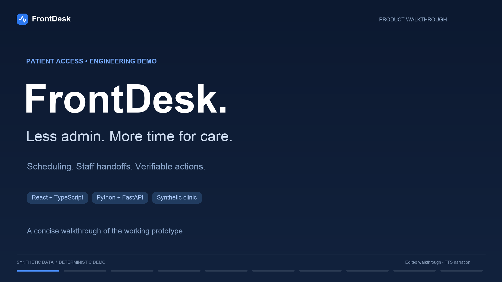
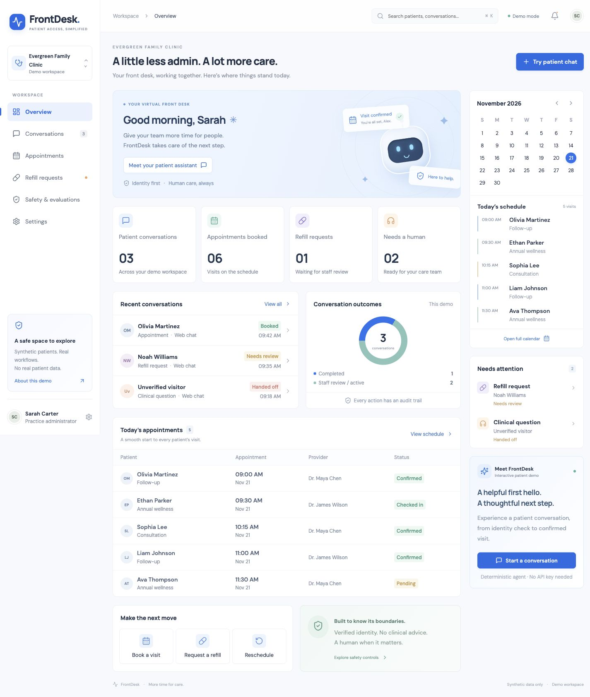
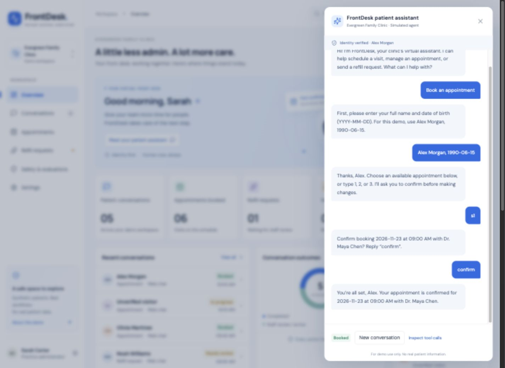

# FrontDesk

A patient-access demo that verifies a synthetic patient, schedules visits, routes refill requests, and gives staff an ordered audit trail.

[**Live demo**](https://just-bharadwaj.github.io/frontdesk/) · [**About & demo video**](https://just-bharadwaj.github.io/frontdesk/about.html) · [**Improvement roadmap**](ROADMAP.md)


## About the project

Clinic front desks handle repetitive appointment and refill requests while clinical questions need a human. FrontDesk explores that boundary through a working patient-access prototype: verify identity, find an available slot, confirm the action, and leave an inspectable trail for staff.

The project demonstrates React/TypeScript product development, Python API design, validated tool execution, synthetic EHR integration, and regression testing. It is a deterministic workflow demo, not a live LLM or a production healthcare service.

## Watch the demo

[](https://just-bharadwaj.github.io/frontdesk/about.html#video)

**2:06 · 1080p · Narrated walkthrough.** [Watch in your browser](https://just-bharadwaj.github.io/frontdesk/about.html#video) · [Download MP4](https://just-bharadwaj.github.io/frontdesk/media/FrontDesk-HR-Demo.mp4) · [Transcript](public/media/FrontDesk-transcript.txt)

The video uses edited captures of the working app and synthetic narration. It distinguishes implemented features from planned phone and model integrations.

## Demo details
**Demo patient:** Alex Morgan · 1990-06-15.
**Runtime:** deterministic workflow agent, with no live LLM or API credentials required.




## Try it in two minutes

1. Click **Try patient chat**, then **Book an appointment**.
2. Use the demo identity, choose a dated slot, and confirm. The appointment appears in the schedule.
3. Click **Inspect tool calls** to see lookup → verification → search → booking.
4. Start another chat and enter “I have chest pain” to demonstrate an immediate emergency interruption.
5. Start a booking and submit the wrong name/DOB twice to demonstrate a staff handoff.
6. Try a refill request. It enters the staff queue for review; it never becomes a prescription approval.

The visual design follows the supplied reference's white sidebar, blue workspace, summary cards, calendar rail, and compact clinic operations layout. The illustrated assistant is CSS artwork.

## What is implemented

- React + TypeScript interface: dashboard, conversation inbox, appointments, refill queue, safety overview, settings.
- Browser-local simulation with persistent demo state, audit export, patient verification and explicit confirmation before booking.
- Optional local FastAPI mode wired to the same UI, with Pydantic tool envelopes and SQLite-backed synthetic EHR.
- Tool routes for find_patient, verify_identity, search_slots, book_appointment, reschedule, cancel, request_refill and handoff_to_staff.
- SQLite uniqueness prevents double-booking; rescheduling is transactional.
- 50 synthetic patients, five providers and 14 days of appointment slots in the Python seed.
- 40 Python checks and eight TypeScript engine checks, with a GitHub Actions workflow.
- Responsive phone layout, search, month navigation, staff review actions and JSON export.

This is a finished demonstration slice of the supplied application plan, not the complete production product described in that plan.

## Run the browser demo

Requires Node 22.18+ (or Node 24/26) and npm.

```sh
npm ci
npm run dev
```

Open the printed localhost URL. The demo runs entirely in your browser. No environment variables or accounts are required. **Settings → Reset demo** restores synthetic seed data on this device.

```sh
npm run build
npm run preview
node --experimental-strip-types --test evals/browser-engine.mjs
```

## Run the connected Python mode

Requires Python 3.11+.

```sh
python3 -m venv .venv
source .venv/bin/activate
pip install -r requirements-lock.txt
uvicorn agent.app:app --host 127.0.0.1 --port 8000
```

In a second terminal run `npm run dev`, then open **http://127.0.0.1:5173/?api=1**. The header reads “Python API”. In this mode messages go through FastAPI and appointments/refills are backed by SQLite. Choose an exact slot ID from the assistant's response. API mode is available on localhost only.

Interactive API docs: **http://127.0.0.1:8000/docs**.
Database path defaults to `frontdesk.db`; set `FRONTDESK_DB` to change it. Appointments and requests persist in SQLite. Conversation state/audit traces are in memory and reset on backend restart. Start a new chat after a restart. Browser mode and API mode use separate data and deliberately have independent demo seeds.

Python API endpoints:

| Endpoint | Purpose |
| --- | --- |
| POST /api/sessions | Create a conversation |
| POST /api/sessions/{id}/messages | Process a turn |
| GET /api/staff/conversations | Conversation and tool audit |
| GET /api/staff/snapshot | Appointment/refill dashboard data |
| POST /api/staff/refills/{id}/forward | Forward a request for clinician review |
| GET /api/ehr/appointment-slots | Available synthetic slots |
| GET /api/ehr/providers | Synthetic providers |
| GET /api/ehr/departments | Synthetic department |

## Architecture

```text
React / TypeScript
 ├─ default: browser state machine → localStorage
 └─ localhost ?api=1: Vite proxy → Python FastAPI
                                  ├─ safety precheck
                                  ├─ identity + confirmation state machine
                                  ├─ Pydantic tool router + ordered trace
                                  └─ SQLite mock EHR
```

The mock uses EHR-style identifiers such as patientid, appointmentid and departmentid. It is not a faithful athenaOne API implementation or an actual athenahealth connection.

## Verified results

Local run on November 21, 2026:

| Check group | Passed |
| --- | ---: |
| Python workflow variants | 8/8 |
| Emergency interruption phrases | 6/6 |
| Clinical escalation phrases | 5/5 |
| Prompt-injection refusal phrases | 4/4 |
| Failed identity variants | 4/4 |
| Tool verification guards | 5/5 |
| Conflict, confirmation, ambiguous date, invalid/past slot, schema, medication, HTTP contract | 8/8 |
| Browser engine workflows | 8/8 |

```sh
python -m pytest evals -q
node --experimental-strip-types --test evals/browser-engine.mjs
npm run build
```

These are deterministic regression checks, not independent clinical validation or LLM quality evaluations. GitHub Actions runs the evaluation workflow on pushes and pull requests; the badges above show the current results. The local Python run emitted one upstream Starlette/httpx deprecation warning.

## Honest limits and next steps

- **No live LLM integration.** Intent routing is regex/state-machine based. It does not understand arbitrary language reliably. A production model adapter should propose typed actions, while the server keeps authority over identity, scope, confirmation and mutations.
- **Synthetic data only. No real PHI.** Browser storage and the local API are unsuitable for actual patient information.
- **Not HIPAA-compliant infrastructure.** Real use would require appropriate agreements/BAAs, encryption, retention controls, authenticated staff access, authorization, durable audit logging, rate limiting and operational review.
- **No medical decisions.** Emergency matching is demonstrative and incomplete. Staff handoffs are queued records, not actual calls or notifications. Refill requests are never approvals.
- **Not a production identity system.** Name and DOB are public demo fixtures. Session IDs are not an authentication model.
- Hosted preview is a static browser simulator; the Python API runs locally. GitHub Pages is public and can be shared with recruiters. The Python API is not deployed on Pages.
- No voice, SMS, fax intake, live EHR, recording, or application submission. A narrated video can follow the demo script in `DEMO_SCRIPT.md`.
- Browser and Python engines are separate implementations; their tests cover key invariants, not complete behavioral parity.
- Live model integration and production-style authentication are the next milestones before presenting this as the full application-plan MVP. See [ROADMAP.md](ROADMAP.md) for prioritized improvements.

## GitHub Pages deployment

The Pages workflow builds the frontend with the repository base path and publishes `dist/`. Tests must pass before deployment. The video and About page are copied from `public/` into the same deployment.

```sh
BASE_PATH=/frontdesk/ npm run build
```

GitHub Pages serves only static assets. The optional Python API still runs locally; no backend secrets are embedded in the public site.
